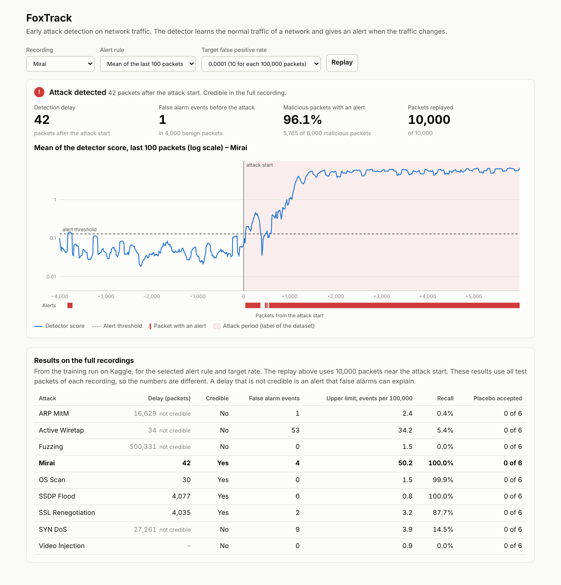
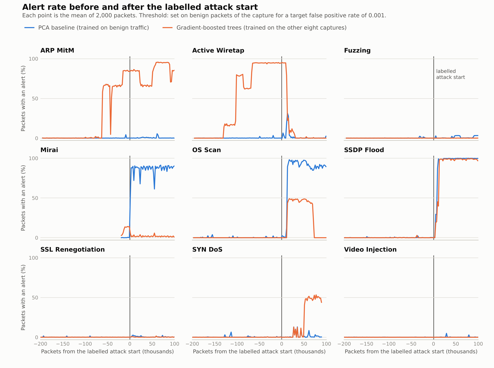

# FoxTrack

**Early attack detection on large-scale network traffic.** DATA 226 group project.

FoxTrack learns the normal traffic of a network and gives an alert when the traffic changes.
The project measures the detection delay in packets, the part of each attack that it
detects, and the false alarms.

It uses the [Kitsune Network Attack Dataset](https://www.kaggle.com/datasets/ymirsky/network-attack-dataset-kitsune):
21.0 million packets in nine recordings, one attack type in each recording.



**Primary results**

- A model trained on normal traffic only gives a credible early detection for five of nine
  attacks, with zero false alarm events in seven of nine recordings.
- Supervised models looked better at first, but they had learned that attacks come near the
  end of each recording, not what an attack looks like. A test confirms this.
- The system is a proof of concept. It is not ready for a production network.

| Part | Technology |
|---|---|
| Data processing | Apache Spark (PySpark), Parquet |
| Models | Spark MLlib: PCA, logistic regression, gradient-boosted trees |
| Experiment records | MLflow |
| Service | FastAPI, NumPy |
| Dashboard | One HTML page, served by the service |
| Compute | Kaggle Notebooks (training), a laptop (service) |

---

## Quick start

### 1. Start the dashboard

You need Python 3. The service was tested with Python 3.13. Spark is not necessary.

```bash
git clone https://github.com/DiscM/DATA-226-FoxTrack.git
```

```bash
cd DATA-226-FoxTrack
```

```bash
pip install -r requirements-serve.txt
```

The dashboard replays recorded packets. These packets are a part of the Kitsune dataset, so
they are not in this repository. Put them in the folder `demo_data/` in one of two ways:

- **From the Kaggle run of notebook 02 (all nine recordings, 27 MB):** the files are in the
  output of the Kaggle notebook `foxtrack-02-baseline-anomaly`, in the folder
  `baseline/demo`. Open the notebook on Kaggle, select **Output**, download the nine `.npz`
  files of that folder, and copy them to `demo_data/`. The notebook is in the Kaggle
  account of the project owner, so you need access to it. If you run notebook 02 in your
  own account, the same folder is in your own output.
- **From the public dataset:** download the two files of a recording from the
  [dataset page](https://www.kaggle.com/datasets/ymirsky/network-attack-dataset-kitsune)
  into a folder with the same name as on Kaggle, then build the demo file. Mirai is the
  smallest recording (1.4 GB). The other feature files are 5 to 12 GB each.

```
kitsune/Mirai Botnet/Mirai_dataset.csv
kitsune/Mirai Botnet/mirai_labels.csv
```

```bash
pip install pandas
```

```bash
python scripts/make_demo_data.py kitsune
```

Then start the service:

```bash
uvicorn foxtrack.api.app:app --app-dir src
```

Open http://127.0.0.1:8000. Select a recording, then select **Replay**. The dashboard sends
10,000 recorded packets through the detector and shows the score, the alerts, the detection
delay, and the false alarm events. The API at `/docs` works with no demo packets.

Good recordings for a first look:

| Recording | What it shows |
|---|---|
| Mirai | A credible detection, 42 packets after the attack start |
| OS Scan | A credible detection with zero false alarm events |
| Active Wiretap | An alert that is not credible |
| ARP MitM | An attack that the model does not detect |

### 2. Use the API

The API page is at http://127.0.0.1:8000/docs.

| Endpoint | Purpose |
|---|---|
| `GET /api/models` | The trained models and their settings |
| `POST /api/predict` | Scores and alerts for a sequence of packets (115 features each) |
| `POST /api/sessions` | Start a detector that keeps its history, for a stream of packets |
| `POST /api/sessions/{id}/packets` | Send the next packets of the stream |
| `GET /api/demo/{model}` | Replay the recorded packets near the attack start |
| `GET /api/results` | Results of the full recordings for one setting |

Example:

```bash
curl -s http://127.0.0.1:8000/api/demo/mirai_botnet | python -c "import sys, json; print(json.load(sys.stdin)['summary'])"
```

### 3. Use the models of the MLflow record

MLflow is the link between training and deployment. Each training run on Kaggle records its
parameters, its metrics, and its trained model in MLflow. The service can take its models
from that record:

```bash
pip install mlflow
```

```bash
FOXTRACK_MLFLOW_DIR=results/mlflow/baseline uvicorn foxtrack.api.app:app --app-dir src
```

The service then selects the newest completed run of each attack. `GET /api/models` and the
dashboard show the MLflow run of each model. With no `FOXTRACK_MLFLOW_DIR`, the service
reads the model files in `models/pca_baseline/`, which are copies of the same models.

To use the models of a new training run, download `mlflow.db` and the folder `mlruns` from
the output of notebook 02, put them in one folder, and set `FOXTRACK_MLFLOW_DIR` to it.

### 4. Run the tests

The tests need Java 17 or later, because some of them start Spark.

```bash
pip install -r requirements.txt
```

```bash
pytest
```

There are 67 tests.

### 5. Train the models again

The training runs on Kaggle, because the dataset is already there and a Kaggle Notebook has
30 GB of memory at no cost.

1. In Kaggle, select **Create > Notebook > File > Import Notebook**, and import a notebook
   from the `notebooks/` folder.
2. Set **Settings > Internet** to on.
3. Add the input, then run all cells.

| Notebook | Input | Purpose | Run time |
|---|---|---|---|
| `01_kaggle_setup_etl` | The Kitsune dataset | Convert the CSV files to Parquet with Spark | 12 minutes |
| `02_baseline_anomaly` | Output of notebook 01 | Train and evaluate the baseline; export the models | 11 to 14 minutes |
| `03_supervised_leave_one_out` | Output of notebook 01 | Train and evaluate the supervised models | 48 minutes |
| `04_time_confound_test` | Output of notebook 01 | Test if the supervised models learned the time | 27 to 42 minutes |

You do not need to run the notebooks to see their results. The folder `notebooks/executed/`
has each notebook with the output of its Kaggle run. GitHub shows them in the browser.

### Repository layout

```
notebooks/               the four Kaggle notebooks
notebooks/executed/      the same notebooks with the output of their Kaggle runs
src/foxtrack/etl.py          CSV to Parquet with Spark
src/foxtrack/split.py        train, calibration, and test ranges
src/foxtrack/anomaly.py      baseline model: scaler and PCA (Spark MLlib)
src/foxtrack/supervised.py   logistic regression and gradient-boosted trees
src/foxtrack/metrics.py      delay, alert rules, false alarm events, credibility, placebo
src/foxtrack/serving/        the trained detector in NumPy, and the loader for an MLflow record
src/foxtrack/demo.py         builds the demo packets from downloaded dataset files
src/foxtrack/api/            the FastAPI service and the dashboard page
models/pca_baseline/     nine trained models
demo_data/               10,000 packets near each attack start (not in git, see Quick start)
results/                 result tables, run logs, MLflow record, and RUNS.md
reports/figures/         figures and dashboard screenshots
scripts/                 figure script and analysis scripts
tests/                   67 tests
```

---

## Report

### 1. The problem

An intrusion detector is useful only if it detects attacks and only if its alerts are
trustworthy. An operator who gets many false alarms stops reading them.

The project has two aims:

1. A reliable detection of each attack.
2. Few false alarms.

The two aims work against each other. A sensitive detector detects more, but it also
alerts on normal traffic. The project measures the two together.

The project also measures the detection delay: the number of packets between the first
malicious packet and the first alert. The delay is not a response time: the project did
not measure how quickly the software processes a packet, or how quickly a person can act on
an alert.

### 2. The dataset

The Kitsune dataset has nine recordings of network traffic. Each recording has one attack
type. Each packet has 115 features, which are statistics of the recent traffic, and a label:
benign or malicious.

| Recording | Packets | First malicious packet | Malicious packets |
|---|---|---|---|
| ARP MitM | 2,504,267 | 1,300,000 | 45.7% |
| Active Wiretap | 2,278,689 | 1,300,000 | 40.5% |
| Fuzzing | 2,244,139 | 1,300,005 | 19.3% |
| Mirai | 764,137 | 121,621 | 84.1% |
| OS Scan | 1,697,851 | 1,314,658 | 3.9% |
| SSDP Flood | 4,077,266 | 2,613,442 | 35.3% |
| SSL Renegotiation | 2,207,571 | 1,320,011 | 4.2% |
| SYN DoS | 2,771,276 | 2,682,349 | 0.25% |
| Video Injection | 2,472,401 | 2,131,050 | 4.1% |
| **Total** | **21,017,597** | | |

Three properties of the dataset control the design of the project:

- **Each recording starts with a long benign period, and the attack starts one time.**
  The dataset authors state this: clean traffic was captured for the first 1 million
  packets of each recording, and then the attack was performed. The Mirai recording is
  shorter.
- **The classes are far from balanced.** The malicious part is from 0.25% to 84%. Accuracy
  is thus not a useful measure.
- **The files have no time values.** The project uses the position of a packet in its
  recording as the time. All delays are in packets, not seconds.

### 3. The method

#### 3.1 Data processing

Spark converts the CSV files to Parquet. The feature file and the label file of a recording
agree only by row position. The conversion thus gives each packet its position and joins
the label on that position. It stops with an error if the number of feature rows and the
number of labels are different.

#### 3.2 The baseline model

The baseline learns only from benign traffic. It needs no examples of attacks. This
approach follows the Kitsune paper, which also learns from the benign start of each
recording. The Kitsune paper uses an ensemble of autoencoders. This project uses a simpler
model, a PCA. The baseline is trained separately for each recording, on the benign period
before the attack:

| Part of the benign period | Use |
|---|---|
| First 70% | Fit a scaler and a PCA with 20 dimensions (Spark MLlib) |
| Next 15% | Set the alert threshold for a target false positive rate |
| Last 15%, and all packets after it | Test. This range has the attack start. |

The score of a packet is its PCA reconstruction error: the part of the packet that the
model of normal traffic cannot rebuild. Traffic that does not look like the training
traffic gets a high score.

#### 3.3 The supervised models

Logistic regression and gradient-boosted trees (Spark MLlib) learn from labelled packets.
Each recording has only one attack start. A model that trains and tests on the same
recording thus cannot measure the delay at that start. The models train on eight
recordings and the test is the ninth. This shows if a model detects an attack type that it
did not see.

The training data is a random sample: at most 100,000 benign and 100,000 malicious packets
from each recording.

#### 3.4 Alert rules

| Rule | An alert occurs when |
|---|---|
| Threshold | The score of one packet is more than the threshold |
| 3 of 5, 10 of 20 | k of the last n scores are more than the threshold |
| Mean of 100 | The mean of the last 100 scores is more than its threshold |

All rules use only past packets, so they can run on live traffic.

#### 3.5 Measures

- **Detection delay:** the number of packets from the first malicious packet to the first
  alert.
- **Recall:** the part of the malicious packets that have an alert.
- **False alarm events:** an event is a sequence of alerts before the attack. Alerts with
  fewer than 100 packets between them are one event. An operator gets one alarm for one
  event.
- **Upper limit of the false alarm rate:** zero events in a limited number of packets does
  not prove a zero rate. The report gives the largest rate that agrees with the data, with
  95% confidence.

#### 3.6 The credibility check

A detector that gives false alarms also gives an "alert" soon after each attack start, by
chance. A delay is thus counted only if two checks pass:

1. **The detector reacts to the attack.** The alert rate on malicious packets is at least
   5 times the alert rate on benign packets before the attack.
2. **False alarms cannot explain the delay.** A detector with no skill, and the same false
   alarms, would give an alert that quickly in at most 5% of cases.

A **placebo test** examines the check itself. The same evaluation runs at false "attack
starts" inside benign traffic, where no attack is. The check must accept almost none of
them.

### 4. Results

#### 4.1 Baseline: early detection

One setting for all attacks: a target false positive rate of 0.0001. The table shows two
alert rules.

| Attack | Delay, 3 of 5 | Delay, mean of 100 | Recall, 3 of 5 / mean of 100 | False alarm events, 3 of 5 / mean of 100 |
|---|---|---|---|---|
| OS Scan | **31** | **30** | 97.5% / 99.9% | 0 / 0 |
| Mirai | **613** | **42** | 87.8% / 100% | 0 / 4 |
| SSDP Flood | **4,057** | **4,077** | 99.9% / 100% | 0 / 0 |
| SSL Renegotiation | **4,229** | **4,035** | 65.7% / 87.7% | 0 / 2 |
| Active Wiretap | **3,907** | not credible | 0.1% / 5.4% | 0 / 53 |
| ARP MitM | not credible | not credible | 0.1% / 0.4% | 1 / 1 |
| SYN DoS | not credible | not credible | 16.4% / 14.5% | 5 / 9 |
| Fuzzing | not credible | not credible | 0.0% / 0.0% | 0 / 0 |
| Video Injection | not credible | not credible | 0.0% / 0.0% | 0 / 0 |

Delays are in packets. A delay in bold passed the credibility check.

- With the rule "3 of 5", five attacks have a credible detection, and seven of nine
  recordings have zero false alarm events.
- The 95% upper limit for zero events is approximately 1.5 events for each 100,000 packets
  for most recordings. For Mirai it is 16, because Mirai has only 18,244 benign test
  packets.
- The two rules have different strengths. The mean of 100 gives a higher recall and a much
  shorter delay for Mirai. The rule "3 of 5" gives fewer false alarm events.
- The detection of Active Wiretap is credible but not useful: the alert comes 3,907 packets
  after the start, and 0.1% of the malicious packets get an alert.
- The baseline detects the attacks that add much new traffic (scans, floods, the botnet).
  It does not detect the attacks that change the traffic only a little.

#### 4.2 Ranking quality of all models

ROC-AUC on the test range of each recording. A value of 0.5 is chance. A value much less
than 0.5 shows that the model ranks benign packets above malicious packets.

| Attack | PCA baseline | Logistic regression | Trees, standard | Trees, time matched |
|---|---|---|---|---|
| SSDP Flood | **0.999** | 0.044 | 0.963 | 0.800 |
| SSL Renegotiation | **0.975** | 0.830 | 0.892 | 0.413 |
| Mirai | **0.946** | 0.065 | 0.067 | 0.392 |
| OS Scan | **0.936** | 0.240 | 0.801 | **0.936** |
| Video Injection | **0.934** | 0.435 | 0.441 | 0.523 |
| SYN DoS | 0.809 | 0.924 | 0.857 | **0.929** |
| Active Wiretap | 0.618 | 0.422 | 0.771 | 0.656 |
| Fuzzing | 0.405 | 0.400 | 0.197 | 0.537 |
| ARP MitM | 0.290 | 0.689 | 0.980 | 0.548 |
| **Median** | **0.934** | 0.422 | 0.801 | 0.548 |

- The baseline has the best median, although it is the only model that sees no labels.
- The supervised models fail on Mirai. Mirai was recorded on a different network, and what
  the models learned from the first network does not apply to the second.
- A good ROC-AUC does not prove good early detection. For Video Injection, the baseline has
  a ROC-AUC of 0.934, but at a strict threshold it detects no malicious packets. This is
  why the project reports the delay and the false alarm events, and not only the ROC-AUC.

#### 4.3 The supervised models and the time in the recording

The standard trees have a ROC-AUC of 0.980 for ARP MitM. The figure below shows that this
number is not what it seems.



For ARP MitM and Active Wiretap, the standard trees (orange) give alerts on benign packets
long before the attack. For Active Wiretap, the alerts also stop while the attack
continues. This led to a question:

> Did the model learn what an attack looks like, or did it only learn that attacks come
> near the end of each recording?

Two tests answer it.

**Test 1: the features contain a clock.** A model was trained on benign packets only, to
tell early packets from late packets. No attack packet is in this test. On a recording that
it did not see, this model has a ROC-AUC of more than 0.85 for six of nine recordings
(for example ARP MitM 0.996, SYN DoS 0.991, Active Wiretap 0.982). The attack model uses
the same features: the 10 most important features of the clock model have 59.7% of the
importance in the attack model.

**Test 2: time-matched training.** The trees were trained again with benign and malicious
packets from the same time in each recording. The time then gives no information. The
table uses a target false positive rate of 0.001 and the plain threshold.

| Recording | Measure | Standard training | Time-matched training |
|---|---|---|---|
| ARP MitM | ROC-AUC | 0.980 | 0.548 |
| ARP MitM | False alarm packets for each 100,000 | 21,854 | 423 |
| Active Wiretap | False alarm packets for each 100,000 | 47,588 | 69 |
| Active Wiretap | Recall | 73.1% | 0.1% |
| OS Scan | ROC-AUC | 0.801 | 0.936 |
| SYN DoS | ROC-AUC | 0.857 | 0.929 |

**The answer.** For ARP MitM and Active Wiretap, the model learned that attacks come near
the end. With time-matched training, the alerts before the attack stop, and the detection
stops too. For OS Scan and SYN DoS, the model learned what the attack looks like, and the
result became better.

A third test removed the 10 most important clock features. It did not correct the problem,
because the time information is in many features.

This result applies to any dataset where each recording has one attack at the end. A
supervised model can learn the position and not the attack, and a standard evaluation does
not show it. The risk is known in security research: Arp et al. (2022) list spurious
correlations, where a model learns a property of the dataset that is not related to the
security task, as a common fault of machine learning in security.

#### 4.4 Checks of the evaluation

- **Placebo test.** The credibility check ran at 648 false attack starts in benign traffic.
  It accepted 5 of them (0.8%). The check permits a chance result in at most 5% of cases.
  The 5 cases are in Fuzzing and ARP MitM, where the benign traffic changes with time.
- **The service agrees with the training run.** The service scores the demo packets with
  the exported models. The largest relative difference from the Spark scores is less than
  1e-10, and the delays in the replay are equal to the delays of the full run.

### 5. Limits

- **The labels mark time periods more than single packets.** Three attack starts are round
  numbers (packet 1,300,000 or 1,300,005). In Mirai, each packet after the start has the
  label malicious. For SSDP Flood, the labelled start is one isolated packet, and the dense
  flood starts 8,307 packets later. A measured delay is only as exact as the label of the
  attack start.
- **Delays are in packets, not seconds.** The feature files have no time values. The
  project thus makes no statement about response time.
- **The false alarm rate is still high for a real network.** A real network carries
  thousands of packets each second.
- **Four attacks are not detected:** ARP MitM, SYN DoS, Fuzzing, and Video Injection. A
  PCA is a simple model.
- **The benign traffic changes with time.** The measured false alarm rate is more than the
  target in most recordings. In Active Wiretap the change is large.
- **The data comes from two small lab networks.** A model that is trained on one network
  does not transfer to a different one.
- **The credibility check assumes that false alarm events occur at a constant rate.** It is
  an approximation.
- **Time-matched training can also remove a real signal.** Benign packets in the attack
  period are possibly affected by the attack.
- **The dataset gives no feature names.** The project did not determine what the clock
  features measure.

### 6. Is it ready for production?

No. The project is a proof of concept. It measures early detection honestly, shows which
attack types a simple model can detect, and identifies what blocks production use.

A production system would need:

1. A much lower false alarm rate, for example with a stronger model and alerts for each
   device.
2. A threshold that adjusts when normal traffic changes.
3. Tests on other networks, and on attacks that come at any time in a recording.
4. A feature extractor that runs on live traffic. The project uses features that are
   already calculated.

### 7. Conclusions

1. **A model of normal traffic is the trustworthy method for early detection on this
   dataset.** It detects five of nine attacks with zero false alarm events in the test, and
   it cannot learn when attacks occur, because it sees no labels.
2. **The false alarm rate, not the model score, limits early detection.** A short delay is
   proof of early detection only if false alarms cannot explain it.
3. **Good supervised results on this type of dataset need a check for the time in the
   recording.** Without the check, two of the best supervised numbers in this project
   would be wrong.

### 8. Records

- `results/RUNS.md` lists each Kaggle run: the notebook version, the code version, the run
  time, the log, and the corrections that later results made.
- `results/logs/` has a copy of the Kaggle log of each run.
- `results/mlflow/baseline/` has the MLflow record of the final baseline run: the database,
  the model file of each run, and a CSV summary. The service can load its models from it
  (see Quick start, step 3). To open the record in the MLflow page:

```bash
mlflow ui --backend-store-uri sqlite:///results/mlflow/baseline/mlflow.db
```

- The score for each packet (335 MB) and the Parquet data stay in the output of the Kaggle
  notebooks. They are too large for this repository.
- The repository has no packets of the Kitsune dataset. The dataset has the licence GNU
  AGPL 3.0 on Kaggle. The repository has the trained models and the result tables, which
  are calculated from the dataset. To make the figure again, download the
  score files and run:

```bash
python scripts/plot_alert_rate_near_onset.py <scores_dir>
```

### References

- Mirsky, Y., Doitshman, T., Elovici, Y., and Shabtai, A. (2018). Kitsune: An Ensemble of
  Autoencoders for Online Network Intrusion Detection. Network and Distributed System
  Security Symposium (NDSS).
- Arp, D., Quiring, E., et al. (2022). Dos and Don'ts of Machine Learning in Computer
  Security. USENIX Security Symposium.
- Kitsune Network Attack Dataset, Kaggle:
  https://www.kaggle.com/datasets/ymirsky/network-attack-dataset-kitsune
